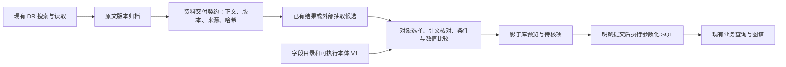

# 可执行本体 V1 与 DR 交付接口

日期：2026-11-13

本轮完成了采集与知识加工之间的资料契约，以及第一版可执行本体规则。规则已经接到现有候选入库预览；后端已重新启动。本轮未调整 SearchOS 或 ours 的搜索、排序、反馈和实验方法，未调用模型，未重新抽取或提交正式知识库中的事实。

## 1. 现在接起来的流程



摘要继续单独保存。交付契约只说明采集拿回了什么，不把知识库空列变成新的搜索目标。业务适配器可以读取现有资料，冻结语料适配器可以离线导出归档；后者没有写入业务库的路径。

## 2. 采集交付接口

`CollectionDelivery` 保存批次标识、可选任务标识、采集器标识及资料列表。每份 `Material` 保存文档与版本 ID、来源地址、标题、正文、正文哈希、表示类型、可选时间和原文件哈希。可选的文本定位必须与对应正文切片完全一致。

程序拒绝正文哈希不符、定位越界、定位文字不符、重复版本和抓取错误占位文本。只拿到解析正文时不会补称为原始 HTML。业务适配器生成的 `source:<revision>` 是版本交付标识，不冒充原 DR 调度批次；归档导出时可显式传入原调查批次 ID。

预览计划保存轻量交付清单与正文哈希，不重复塞入整份正文。原文仍由原来的归档管理。七维字段目录仍是权威定义。

## 3. 本体规则已经能执行什么

| 规则 | 当前处理 |
| --- | --- |
| 对象和属性 | 稳定 ID 或属性不同就分别保留，不凭近似名称合并 |
| 版本和工况 | 比较版本、工况及统计口径；只规范已配置的条件别名和明确的单位量 |
| 有效时间 | 有效时间与发布时间分开；时间不重叠不直接认定冲突，也不自动认定发生演化 |
| 数值和范围 | 用 Pint 换算可兼容单位；同条件数值不同进入待核，区间重叠保留不确定性 |
| 事实性质 | 厂商声明、测量、独立复测、转述和推导分别记录，避免混为同一类事实 |
| 证据要求 | 根据事实性质检查材料类型、直接性、对象和条件、事实 ID、已核验的形成来源；转载共享来源 ID，只计一个来源 |
| 状态变化 | “计划／进行中→完成”需对齐事件、版本、条件、有效时间，并提供相符的完成证据 |
| 技术层级 | NetworkX 检查明确的子类路径及分类环；技术分类路径不推出某产品采用了具体算法 |

比较结果包括：等价、范围可兼容、不同版本、不同工况、不同时间、不同事实性质、候选取值冲突、无法判断。比较条件缺失时返回“无法判断”，不把缺项当作相同工况。

V1 为指标比较要求版本、工况、有效时间、统计口径和事实性质；其他记录类型有各自的要求。这是一版保守的领域规则，后续可按事实类型细化。“独立复测需要两个独立形成来源”也是本版配置，属于可调整的证据政策。

## 4. 接进入库预览的部分

外部抽取结果可在原来的 `qualifiers` 中补充 `ontology_context`，不需要改变采集协议。例如：

```json
{
  "ontology_context": {
    "version": "v2",
    "conditions": {"bandwidth": "20 MHz", "payload": "standard"},
    "valid_from": "2026-01-01",
    "valid_to": "2026-12-31",
    "statistic": "maximum",
    "nature": "measurement"
  }
}
```

这些值必须有资料依据。没有的信息不填；不能为了通过比较而编造版本、工况或有效期。程序仍会分别标明“条件结构齐全”和“原文语义尚待核验”。

入库预览保存类型化候选、原文定位、本体版本、条件缺项和新旧比较结果。同条件取值冲突保留旧记录，新候选进入待核；旧数据条件不全但出现候选差异时，继续沿用保守拦截，并明确说明尚不能认定真实冲突。没有自动覆盖、撤回或合并已有事实。

规则配置和字段目录共同进入本体快照。规则或配置更新后，旧的未提交计划必须重新预览；已完成提交仍按原回执幂等返回。发布仍使用原来的签名计划、参数化 SQL、事务和整库指纹检查。

## 5. 已完成和后续工作的界线

**已接入业务预览：** 资料契约检查、类型化条件、条件完整性检查、同对象新旧数值／属性比较、版本化核验结果和发布计划校验。

**已实现并离线验证的算子：** 证据要求与来源去重、事件完成核验、技术分类路径检查。证据算子只接受绑定具体事实的已核验记录；抽取结果不能通过填写 `verified=true` 自行批准自己的证据。

**尚未接通：** 持久化证据核验台账、出处传播链的自动溯源、事件核验算子和业务修订队列的衔接、四类冲突的完整处理流程、旧事实撤回与引用影响传播。业务预览暂不传入已核验证据，因此证据结论保留待核；不能把规则实现说成资料已经完成真实性核验。

**动态本体尚未实现自动演化。** 本轮已具备带版本的规则配置和快照。下一步建议依次实现：

1. 证据核验台账：记录针对哪个事实、哪个原文版本、何种材料、哪个形成来源及谁做了核验。
2. 本体变更提案：新术语、条件别名、字段约束和证据规则以候选变更提交。
3. 影响预览：程序检查类型、分类环和受影响记录；先出清单，不自动修改库表。
4. 显式发布新版本：保留旧版，针对实际受影响的记录重算检查结果。
5. 将需要补证据的事项交给调查管理；是否联网和采集排序继续由现有 DR 机制控制。

本轮直接复用 Pydantic、Pint、NetworkX 和既有 RapidFuzz。LinkML、Graphiti、AutoSchemaKG 等尚未引入运行链路。

## 6. 实现位置与使用入口

以下路径相对 `research-workbench`：

| 位置 | 职责 |
| --- | --- |
| `searchos/knowledge_quality/materials.py` | 独立资料交付契约及归档读取 |
| `searchos/knowledge_quality/ontology.py`、`ontology_v1.json` | 本体类型和版本化规则配置 |
| `searchos/knowledge_quality/reasoning.py` | 条件比较、证据要求、状态变化和分类路径算子 |
| `searchos/knowledge_quality/registry.py` | 规则签名与本体快照 |
| `web/api/knowledge_handoff/quality.py` | 业务资料和已有候选记录适配 |
| `web/api/knowledge_handoff/review.py` | 预览接入，保留既有确认提交路径 |

本地只读接口：

- `GET /api/research-database/handoff/ontology`：规则、版本和类型结构。
- `GET /api/research-database/handoff/contract`：原抽取契约及新增条件结构。
- `GET /api/research-database/handoff/documents/{document_id}/delivery?slug=anduril`：当前专题授权资料的交付内容。

在 `research-workbench` 目录执行：

```bash
# 查看本体与资料契约
.venv/bin/python -m searchos.knowledge_quality ontology

# 校验已有交付 JSON
.venv/bin/python -m searchos.knowledge_quality validate-delivery /实际路径/delivery.json

# 从含 manifest.json 的冻结归档目录导出；只输出 JSON，不写业务库
.venv/bin/python -m searchos.knowledge_quality export-archive /实际路径/归档目录 --run-id 调查批次编号

# 比较包含 left、right 两个 Fact 对象的 JSON
.venv/bin/python -m searchos.knowledge_quality compare /实际路径/pair.json
```

## 7. 验证结果

- 124 项相关离线检查通过，覆盖资料完整性、工况和单位比较、来源去重、状态变化、分类约束、预览与提交、专题读取，以及既有 DR 自适应排序和探索模块；未知条件和近似区间保留不确定性。
- 修改涉及的 Python 文件静态检查通过。
- 正式 Anduril 库只读备份后，在临时副本预览 Extended Range Sentry Towers 的展开时间、Altius-700M 的直径、Ghost-X 的续航记录；保留原始比较符和限定信息后，三项均识别已有指标，没有未映射项或新增冲突。正式库逻辑指纹不变。
- 核对本轮开始保存的 DR 核心与实验目录文件指纹，无变化。
- 加载后端后，本体接口、抽取契约、业务资料交付和本机首页均返回 200。
- 自动抽取仍关闭，排队及运行中的抽取任务均为 0。测试没有调用付费模型，没有将实验资料接入业务库。

本轮代码保存在本地工作区，尚未另行提交或推送 GitHub。
