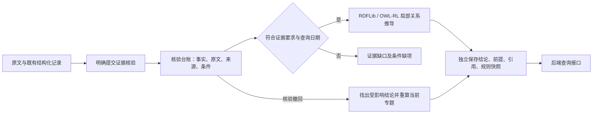

# 证据核验与本体推导实现记录

日期：2026-11-13

本轮把“核验记录→本体推导→依据保存→前提撤回后重算”接成了可运行的后端流程。实际使用 RDFLib 和 OWL-RL 进行关系推导，保留原来的 SQLite 主库、七维字段及图谱。DR 采集、排序和实验方法没有修改，模型抽取继续关闭。

## 本体现在怎样参与计算

业务库已有 `uses_technology`（采用技术）和 `subtechnology_of`（下位技术属于）关系。程序选出当前专题、查询日期下证据满足规则的记录，构建临时语义图，再执行 `analysis.ttl` 中的关系链规则：

```text
产品 P 采用技术 T
T 属于技术类别 C
→ P 有采用 C 类技术的记录
```

OWL-RL 负责关系闭包计算；程序核对输出是否有对应的原始路径，并记录具体前提。同一个技术 ID 同时出现在两个产品的有效技术记录中时，生成“共同技术”分析结果，分别保留两个产品的版本、条件和证据性质。

这能回答“哪些产品有共同技术基础、共同点沿哪条分类路径形成”。它不推出两个产品性能相同、一定具有相同功能或可直接替代。

当前流程：



## 证据核验如何落库

每次核验必须选择已有事实及其证据，并绑定当前事实和原文的摘要指纹。程序检查引文是否仍能在对应版本中定位；其他事实的证据不能挪来核验当前事实。

核验记录保存核验人、依据说明、材料类型、直接或转述性质、已归档的形成来源版本，以及核验后的适用条件。抽取候选中的 `verified` 字样不被读取为核验决定。

形成来源使用原始文档 ID 去重：同一原文的不同版本不会被算作多个独立来源；转载应在核验时指向共同的原始材料。当前仍需要明确核对出处传播链，程序没有自动完成互联网溯源。厂商声明与实测结果继续按不同证据要求处理。

核验条件互相矛盾或合格正反证并存时保留争议。历史事实未提供完整条件的，可以在明确的核验记录中补充有依据的条件，不会直接改写旧事实；没有依据的条件继续留空。

## 结论如何保留解释和失效状态

每条推导保存：

- 结论类型、对象和技术 ID；
- 使用的事实 ID 与核验记录 ID；
- 实际使用的原文引句、版本和定位；
- 每个前提各自的版本、条件、事实性质及有效时间；
- 规则 ID、OWL-RL 版本、本体配置和关系规则快照；
- 分析日期、输入指纹和分析批次 ID。

结论与直接资料事实分开存储，没有自动插入原来的事实表或修改图谱。核验撤回时，会返回受影响的结论 ID，并重新计算当前专题；旧结果保留在历史批次中。原事实被撤回、对象状态变化或规则更新时，旧批次查询会显示已失效，新分析读取当前状态。

当前重算粒度是一个专题，不是全库，也尚未细化到只执行个别受影响规则。分类环只阻止相关分类路径，不阻止无关的直接技术关系。

## 数据库扩展与隔离

新增五张独立表，通过显式的附加迁移安装，原七维库的不可变 V1 结构校验保持有效：

| 表 | 保存内容 |
| --- | --- |
| `quality_evidence_reviews` | 追加式证据核验记录 |
| `quality_review_withdrawals` | 核验撤回记录 |
| `quality_analysis_runs` | 分析批次、输入指纹和规则快照 |
| `quality_conclusions` | 推导结果与证据缺口 |
| `quality_conclusion_premises` | 结论对事实、核验记录的实际依赖 |

所有内容通过程序生成的参数化 SQL 写入。只读分析不保存记录；保存分析、提交核验及撤回核验是明确的写入操作。新表不产生自动采集任务，实验目录不能作为该业务模块的数据库。

正式库扩展前的备份：

`research-workbench/data/knowledge/backups/before-evidence-analysis-20261113-112755.sqlite`

扩展安装和首次分析保存之后，原有事实、对象、证据和原文相关表的内容指纹保持一致。

## 已有资料与验证结果

本轮检查了 Anduril 专题中适用于当前分析范围的 **988 条记录**，范围为采用技术、技术上下位、指标和功能。它们尚无本轮台账中的有效核验，因此首次结果为 **988 条待核缺口、0 条正式推导**。已有资料和图谱仍在原处，缺口表示新的证据要求尚未满足，不表示资料被删除或采集失败。

在独立临时库中，用合成的产品 A、产品 B、检测算法、目标检测和计算机视觉记录验证：

| 场景 | 结果 |
| --- | --- |
| 资料已入库，但没有证据核验 | 不生成正式推导，列出待核项 |
| 四项前提完成核验 | 生成上位技术应用与共同技术结果，保留全部前提和引文 |
| 撤回上位分类的核验 | 旧分析批次失效，重算后保留仍有依据的直接共同技术 |
| 撤回产品采用关系 | 该产品对应的共同技术结论不再出现 |
| 同一原始文档存在多个版本 | 独立来源仍只计一个 |
| 增加合格反证 | 保留争议，不按多数来源投票 |
| 查询日期超出有效范围、条件缺失或分类成环 | 返回缺口或暂停相关路径 |

133 项相关离线检查通过，覆盖新的台账和分析流程、既有入库预览、数据库读取，以及 DR 排序和探索模块。最后补充规则快照后，9 项新链路检查再次通过。测试未联网、未调用模型；合成数据未进入正式业务库。

## 后端使用入口

接口位于 `/api/research-database/handoff`：

| 接口 | 用途 |
| --- | --- |
| `GET /analysis?slug=anduril&as_of=2026-11-13` | 只读计算当前结果 |
| `POST /analysis/runs` | 保存本次分析，重复相同输入复用批次 |
| `GET /analysis/runs/{run_id}?slug=anduril` | 查看历史分析及是否已失效 |
| `GET /evidence/claims/{claim_id}?slug=anduril` | 读取事实、原文证据、指纹、核验历史及当前判断 |
| `POST /evidence/reviews` | 明确提交一项证据核验，并重算专题 |
| `POST /evidence/reviews/{review_id}/withdraw` | 撤回核验、返回受影响结论并重算专题 |

在 `research-workbench` 目录执行以下命令，只做本地计算：

```bash
.venv/bin/python -m searchos.knowledge_quality analyze \
  --database data/knowledge/research.sqlite --slug anduril
```

需要保存分析时追加 `--save`；需要分析历史日期时追加 `--as-of YYYY-MM-DD`。读取具体事实使用 `inspect-claim 事实ID --database data/knowledge/research.sqlite --slug anduril`。

核验提交格式为 `{"slug":"anduril","review":{...}}`。其中 `review` 必须包含 `claim_id`、已有 `evidence_id`、读取时的 `expected_claim_digest`、`reviewer` 和 `note`；材料类型、形成来源和适用条件应来自核验结果。两个确认项 `scope_verified`、`origin_verified` 默认均为 false。确实核验后才提交为 true。

## 开源复用与下一步

本轮实际使用 [RDFLib](https://github.com/RDFLib/rdflib) 7.6.0 和 [OWL-RL](https://github.com/RDFLib/OWL-RL) 7.6.2；现有 Pint 继续处理单位，NetworkX 用于原始路径解释和分类环检查。OpenCTI 的关系推导及直接关系／推导关系分离方式属于设计参考，没有搬入整个平台。

动态本体的自动提案、影响预览和版本发布工作流尚未实现。下一步应建立“提出新概念或规则修改→检查影响→明确发布新版本→重算受影响专题”的链路，复用本轮已经保存的规则快照、输入指纹和依赖记录。前端展示可以随后使用这些接口，现有图谱保持不变。

本轮代码保存在本地工作区，尚未另行提交或推送 GitHub。
