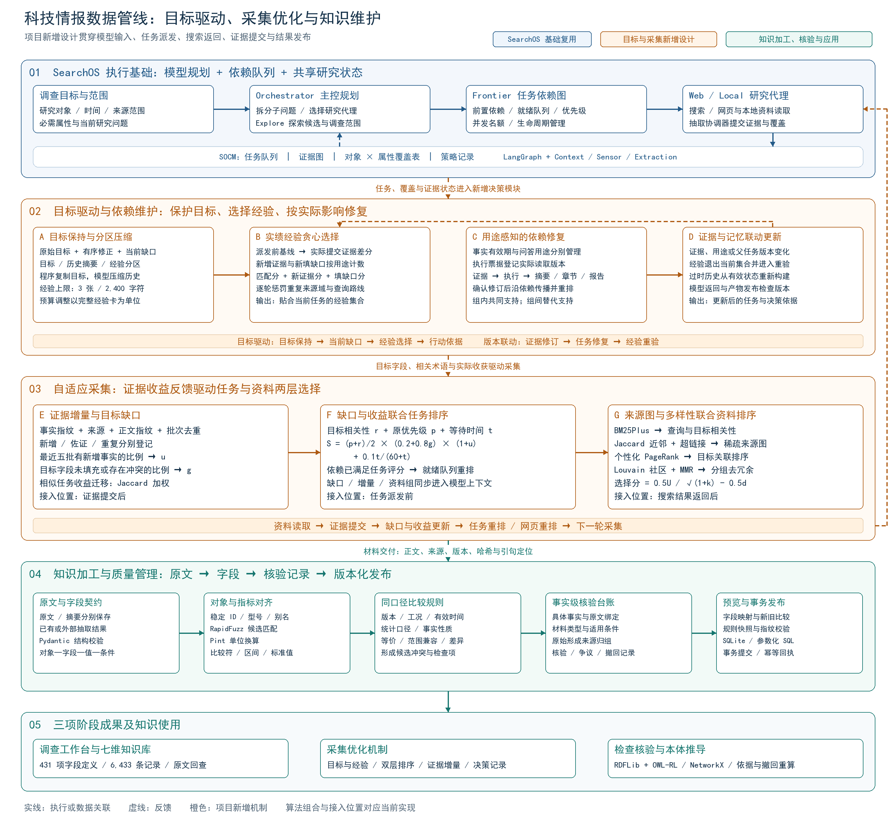
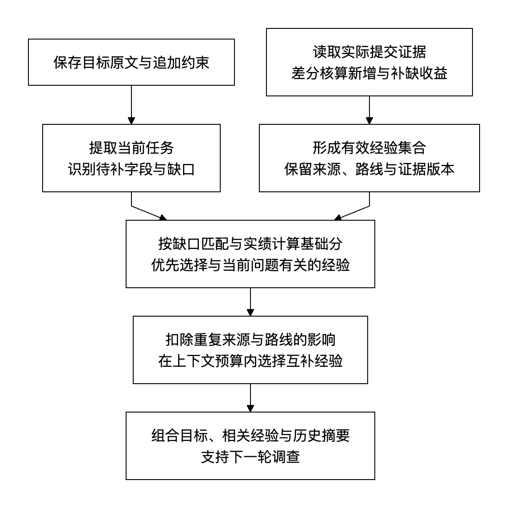
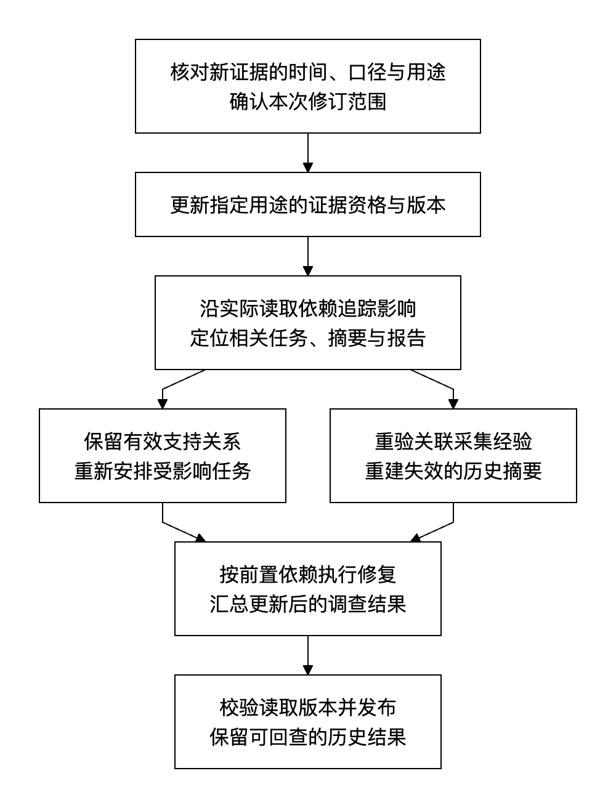
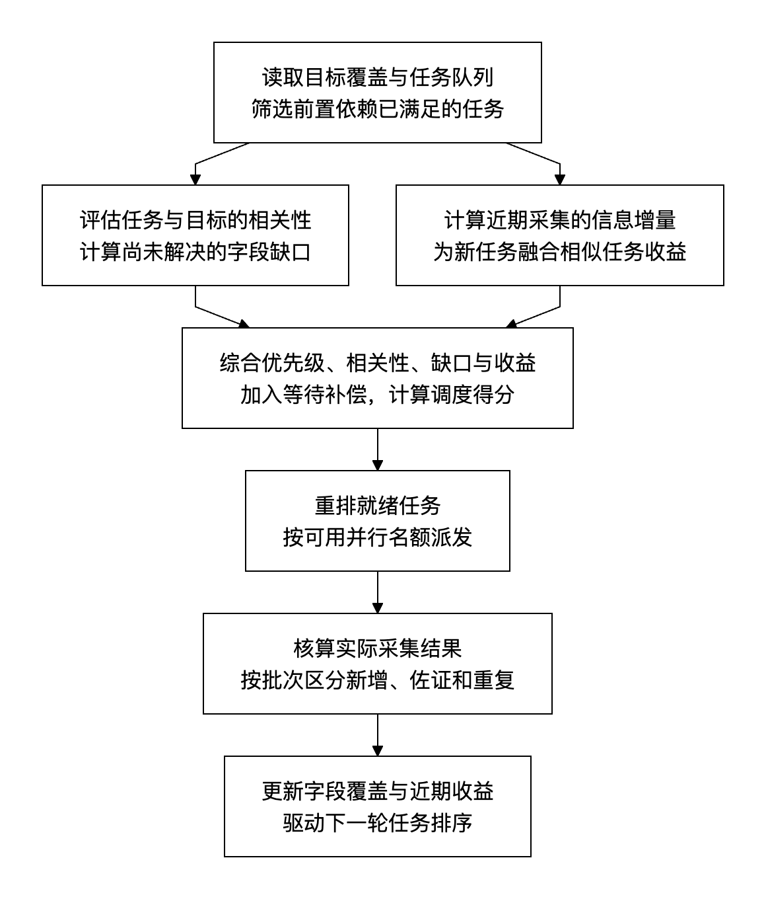
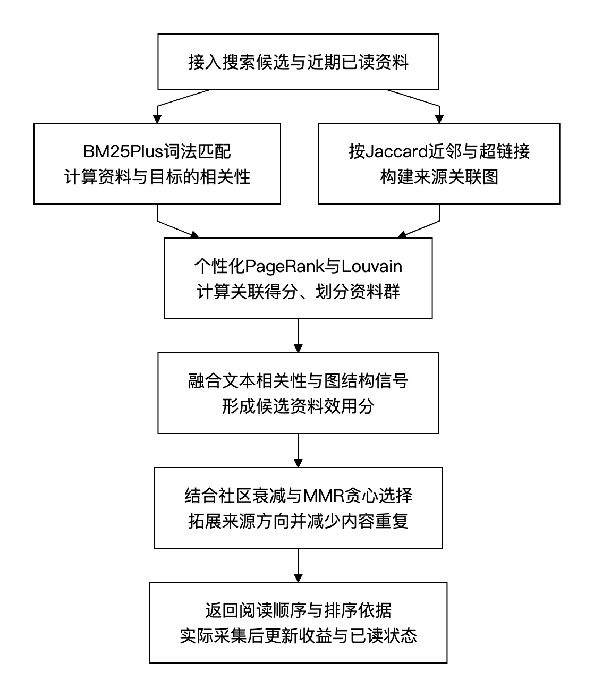
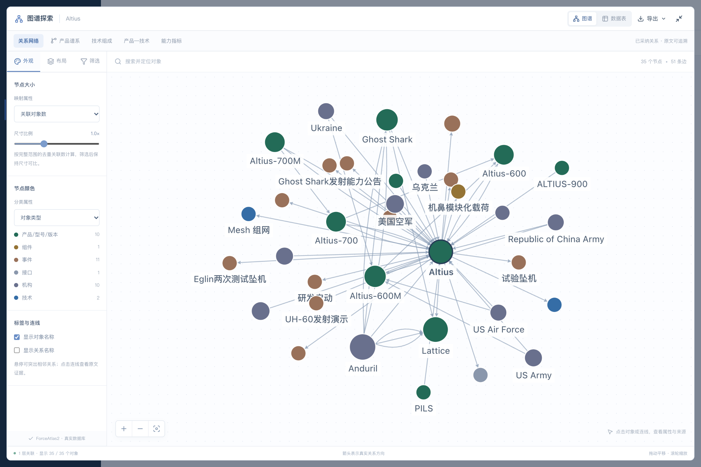
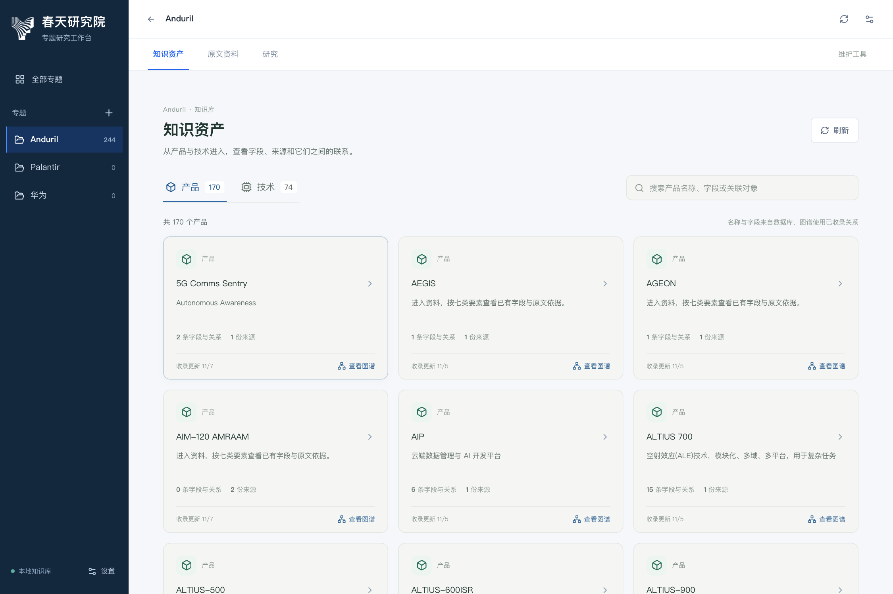
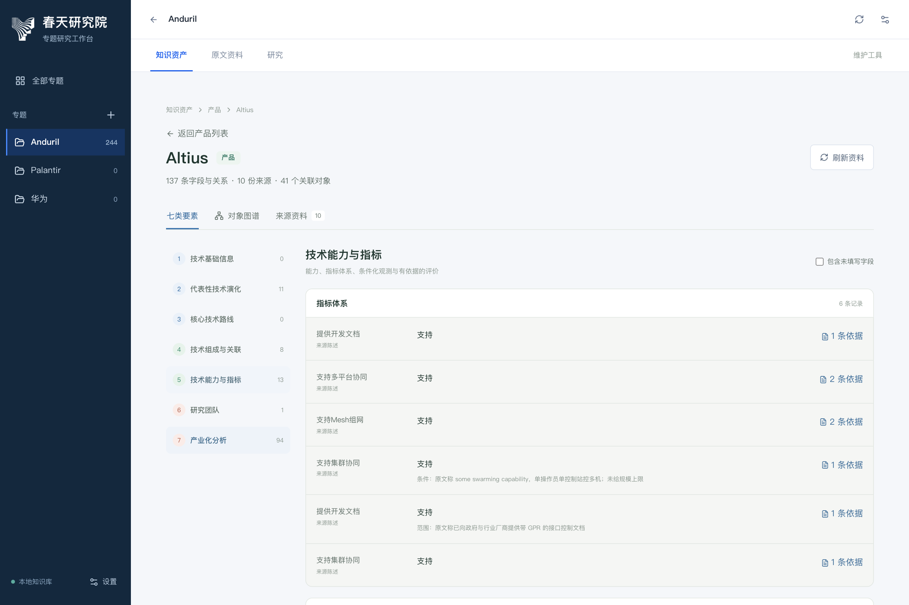
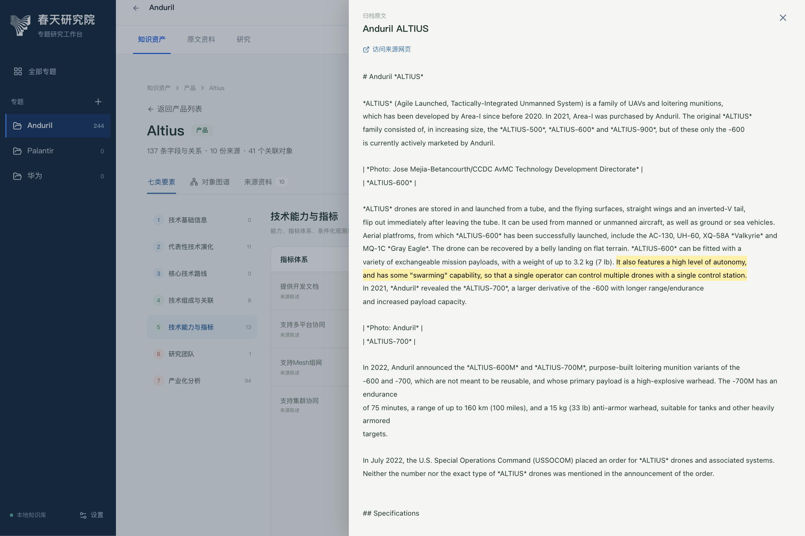

# 面向科技情报的高质量数据管线建设进展报告

2026年11月16日

本项目围绕科技情报研究中的连续调查、资料加工和知识复用需求，以开源 SearchOS 为基础框架，开展**目标驱动的调查组织、自适应采集、证据修订与知识加工**四方面建设。目前形成**调查工作台、采集优化机制、检查核验与本体推导**三项阶段成果。以 Anduril（美国防务科技企业）专题为代表，业务库已归档 **139份来源文档**，形成 **6,433条结构化记录**，覆盖 **998个知识对象**。

## 一 建设背景与目的

科技情报资料分布于企业官网、产品说明、技术文献和新闻公告中，同一对象的名称、型号版本、参数单位和时间口径各不相同。连续调查还会遇到三个相互关联的问题：随着调查轮次增加，原始目标和约束容易在历史摘要中淡化；资料不断增加，重复信息与尚未解决的关键缺口混杂；新证据改变已有判断后，旧摘要、后续任务和知识记录需要同步调整。

项目的建设目的是，**围绕研究目标组织调查，将自然语言资料加工为带有对象、字段、关系和原文依据的知识记录，并使采集与知识维护能够随证据变化持续更新**。具体落实为三项任务：

1. **保持调查目标，组织连续研究。** 保存总目标、追加约束和当前子任务，将目标落实到待获取字段，利用已有采集经验支持后续调查。
2. **根据缺口和实际收获调整采集。** 同时优化“先解决哪个问题”和“先阅读哪些资料”，将新增证据、重复信息与字段覆盖反馈到下一轮选择。
3. **形成可查询、可比较、可追溯的知识资产。** 统一对象、指标与关系表达，通过原文核验、本体规则和版本管理支持产品对比、技术梳理及专题研判。

*图1 数据管线总体技术架构与项目新增设计*

图1展示 SearchOS 执行基础、目标驱动与依赖维护、自适应采集、知识加工和专题应用五个层次。项目新增设计贯穿**目标保持—经验选择—采集排序—证据修订—知识发布**，分别作用于模型输入、任务派发、搜索返回、证据提交和结果发布等执行环节。

## 二 技术路线与算法设计

### 1 以 SearchOS 构建调查执行与共享状态基础

SearchOS 基于 LangGraph 组织多智能体调查。主控智能体 Orchestrator 分解研究问题，按需调用探索、网络研究和本地研究智能体。Frontier 将子任务组织为带前置依赖的有向图，筛选就绪任务并控制并行执行；SOCM（面向搜索的上下文管理）保存研究状态，为连续调查提供共同的数据基础。

*表1 基础框架与项目新增设计的对应关系*

| 技术环节 | SearchOS 提供的基础 | 本项目新增算法或设计 |
| --- | --- | --- |
| 任务规划与执行 | 模型规划、Frontier 依赖队列、并行调度 | 依据实际读取关系传播修订，安排受影响分支重算；按目标缺口和信息增量重排就绪任务 |
| 上下文管理 | 历史摘要、近期交互保留、阈值触发压缩 | 目标、历史摘要与采集经验分区；目标原文保护；按当前缺口选择实绩经验 |
| 调查状态共享 | 任务队列、证据图、对象与属性覆盖表、策略记录 | 证据用途与版本登记、经验收益核算、目标覆盖反馈及失效联动 |
| 搜索与资料读取 | 搜索工具、网页读取、本地文档读取、抽取中间层 | BM25Plus、来源图、个性化 PageRank、Louvain 与 MMR 联合排序 |
| 知识积累与分析 | 调查事实及其来源记录 | 七维字段框架、对象与单位对齐、核验台账、规则推导及版本化发布 |

框架中的上下文、监测和抽取中间层，分别负责组织模型输入、监测预算与进展、将阅读结果转为带来源的候选事实。本项目在这些执行位置接入新增模块，沿用同一套任务、证据和覆盖状态，衔接专题业务库与调查工作台。

### 2 以目标驱动记忆和依赖修复组织长程调查

前期研究形成P1证据修订与P2目标驱动记忆两个模块，已完成运行链接入和合成场景验证，作为默认关闭的可选研究增强保留。

本项目在调查组织方面形成两项相互联动的设计：**目标驱动记忆**管理“当前要完成什么、哪些采集经验值得复用”；**用途感知的证据修订与依赖修复**管理“哪些依据仍然有效、哪些后续工作需要重算”。两者通过证据版本和实际读取关系连接，构成长程调查的状态维护机制。

#### （1）目标保持：将用户目标与可压缩历史分开管理

建立独立的目标状态，逐字保存原始目标和按顺序发生的用户修正，另行记录显式约束、必需属性、当前子任务及对应缺口。每次组织模型输入时，由程序从持久状态生成目标块；历史摘要负责压缩已完成工作、观察和未决事项。

这一设计把**长期目标和当前行动目标同时带入每轮决策**：总目标说明研究目的，当前任务说明正在解决的问题，目标字段和覆盖缺口说明尚缺哪些信息。目标版本与历史摘要分开维护，用户对范围的连续修改能够按原顺序保留。

#### （2）经验形成：以实际提交证据核算一次采集的收益

在任务派发前记录证据和已填字段的基线，在任务完成时读取抽取协调器实际提交的证据，生成采集经验卡。卡片保存问题、查询、执行路线、来源、目标字段、证据版本，以及新增证据、已补缺口、重复信息和已记录成本。

经验收益采用**基线差分与按用途去重**：计算本次提交相对派发前状态增加了哪些证据；同一证据在同一用途中只获得一次新增计数；新填字段还要检查其是否由本次新证据独立支撑。具有成功采集路线和可定位原文的新证据，才进入正向经验集合。这使经验选择建立在实际采集结果上。

#### （3）经验选择：采用缺口匹配、实绩加权和多样性惩罚的贪心算法

选择器将当前任务、目标字段与缺口组合成查询，使用英文词项和中文双字提取匹配信号，再结合经验卡中的新增证据和已填缺口评分。当前实现的基础分为：

`经验基础分 B = 10m + min(n, 4) + 2 × min(f, 3)`

其中，m 为任务与经验的匹配词项数，n 为该经验获计的新证据数，f 为该经验新填补的缺口数。每轮贪心选择还计算：

`经验选择分 E = B − 4D − 8R`

D 表示与已选经验存在来源域名重复，R 表示查询与路线组合重复，均取0或1。每选中一张卡，就更新已选域名与路线集合，再评价剩余卡片。**本项目将当前目标、已观察收益和经验多样性共同用于选择**，使有限上下文优先承载与当前缺口有关的有效线索。

#### （4）目标驱动压缩：在预算内保留目标、相关经验和必要历史

上下文由目标块、历史摘要和采集经验块组成。默认最多选择 **3张经验卡、合计2,400字符**；预算不足时按完整卡片调整，保持目标与约束原文完整。模型请求还统一核算系统提示、工具定义和输出预留。

压缩之后，模型仍可同时看到研究目的、当前缺口与有依据的采集路线。目标保护由程序实现，经验筛选采用确定性计算，历史摘要沿用框架的模型压缩能力。

*图2 目标保持、实绩核算与经验选择流程*

#### （5）依赖修复：沿实际读取关系传播证据修订

将事实身份与事实在某个问题中的用途分别管理。例如，某人的任职记录可以继续支撑历史更替过程，同时退出“当前负责人”这一用途。时间与口径规则先识别可兼容的事实；确认修订后，更新指定用途中的证据资格。

每次执行登记实际读取的证据、任务摘要和章节版本，形成**证据—执行—产物依赖关系**。修订发生后，程序沿依赖关系查找受影响的任务、章节与报告，将相应分支重新排队，保持独立分支可用。支持关系采用“组内共同成立、组间可替代”的结构，保留仍然成立的已登记支持组合；提交结果时校验读取版本，防止旧执行覆盖新状态。

#### （6）记忆联动更新：将证据变化同步传递到经验与摘要

经验卡引用其收益所依赖的证据与父任务版本。证据用途、版本、来源范围或父任务产物变化时，相关经验进入重验状态，退出当前可选集合；依赖失效的历史摘要从当前有效状态重新构建，保留用户原始指令。

由此形成**“证据修订—依赖修复—经验重验—上下文重建”联动**。目标驱动贯穿目标保存、缺口呈现、经验检索和采集决策，证据更新则同步维护这些决策依据的有效性。

*图3 证据修订、依赖修复与记忆更新流程*

### 3 以缺口和信息增量驱动自适应采集

自适应采集同时处理任务层和资料层两个决策。算法接入**搜索结果返回、就绪任务派发、证据提交**三个位置，以同一套目标状态和收益记录驱动下一轮选择。具体新增设计包括六项。

#### （1）目标缺口量化：将研究目标投影为可计算的采集状态

任务登记目标字段、关键术语和中英文别名。对于绑定覆盖表的任务，程序计算未填充或存在冲突的目标字段占比，得到缺口 g；其他任务结合阅读结果中的覆盖判断保存当前状态及判断来源。目标变化与新证据提交后更新缺口，供任务排序、资料排序和主控决策共同使用。

#### （2）证据增量核算：区分新增、佐证与重复并抑制重试计数

对事实内容、来源地址和正文分别建立标识。事实指纹规范空白与大小写，保留数值、单位和否定表达；结合已见事实、同源重复及相同正文，登记新增、佐证或重复信息。以任务、来源、正文指纹和用途构成批次标识，同批次重试只计一次。

近期收益 u 定义为**最近最多五批资料中产生新增事实的批次比例**。该指标回答当前方向是否仍在持续提供新信息，并随采集结果滚动更新。

#### （3）任务优先级自适应：综合相关性、缺口、收益和等待补偿

使用 BM25 计算任务与总体目标的相关性 r，结合原始优先级 p、缺口 g、近期收益 u 和等待秒数 t，对已经满足前置依赖的任务评分：

`S = (p + r) / 2 × (0.2 + 0.8g) × (1 + u) + 0.1t / (60 + t)`

其中，缺口项提高未解决问题的优先程度，收益项提高近期有效方向的优先程度，等待补偿缓解低分任务长期排队。新任务尚无自身采集反馈时，按词项 Jaccard 相似度选择最相关的已有任务，将其近期收益与默认收益0.5加权融合。该设计将历史采集反馈传递到相关的后续问题，形成可解释的调度依据。

*图4 缺口与信息增量驱动的自适应任务调度流程*

#### （4）目标引导的来源图排序：联合文本相关性与资料关联结构

先以中文双字、英文词项和 BM25Plus 计算候选资料与查询、任务及别名的相关性。随后构建稀疏来源图：每份资料连接词汇 Jaccard 相似度最高的至多5个非零邻居，并补充实际超链接边。

以任务相关性和目标权重作为个性化 PageRank 的起点分布，计算资料在当前目标关联网络中的位置，再与文本相关性组合为资料效用分。图中纳入本轮搜索结果及近期已读资料，使排序能够参考已有调查上下文。

#### （5）社区约束的去冗余选择：控制同类资料重复占据阅读序列

使用 Louvain 识别来源图中的资料社区，再执行带社区衰减的 MMR（最大边际相关性）贪心选择：

`资料选择分 M = 0.5 × U / √(1 + k) − 0.5 × d`

U 为归一化资料效用，k 为该社区已选资料数，d 为候选与已读、已选资料的最大词汇相似度。每选出一份资料，就更新其余候选的冗余值和社区计数。**社区衰减拓展资料方向，冗余惩罚减少相似内容连续占据前排**，共同决定搜索结果的阅读顺序。

#### （6）采集反馈与规划联动：把实际收获返回下一轮调查

证据提交后，将缺口、新增、佐证、重复以及各资料组已读情况写入研究上下文；任务评分进入 Frontier，网页顺序返回搜索代理。主控据此继续深入有新增的线索，或为低收益且未解决的方向调整查询与来源。

这一机制将三类计算连成循环：**证据收益核算更新状态，任务排序分配调查重点，资料排序组织阅读顺序**。排序与反馈由程序执行，复用已有抽取结果。

*图5 目标引导的来源排序与去冗余选择流程*

### 4 以统一字段和本体规则组织知识加工

知识加工围绕**自然语言资料到数据字段、数据字段到可核验事实、有效事实到可追溯分析**展开。具体完成以下七项工作。

#### （1）原文交付与定位：建立资料版本和证据位置契约

统一保存正文、来源、内容哈希、版本编号和引句位置，将原文与摘要分别归档。候选记录绑定具体正文版本，核验时检查引句是否位于所登记位置，使字段记录能够回到实际材料。

#### （2）字段建模：将自然语言描述拆为类型化记录

按“对象—属性或关系—取值—条件—时间—证据”组织候选，使用 Pydantic 校验结构，并映射到统一字段目录。已有或外部抽取结果经过映射、预览和确认后进入业务库。已归档的 Extended Range Sentry Towers 材料提供了如下实例。

*表2 自然语言描述到数据字段的加工实例*

| 加工项 | 对应内容 | 设计作用 |
| --- | --- | --- |
| 原文描述 | “can be erected in less than three hours” | 保存原始表述，作为字段解释依据 |
| 对象绑定 | Extended Range Sentry Towers | 结合同份材料上下文绑定具体产品 |
| 指标字段 | 展开时间 | 将自然语言表达映射到指标名称 |
| 取值表达 | 比较关系为“小于”，数值为3，单位为小时 | 在标准数值之外保留限定含义 |
| 来源关联 | The Defense Post《Anduril to Supply 200+ Tactical Sensing Towers to US Border Patrol》及正文版本 | 将记录与可回查材料连接 |

#### （3）对象对齐：结合稳定标识和受约束的名称匹配

优先按稳定ID、准确型号及已确认别名匹配对象；使用 RapidFuzz 名称相似度提供候选，再结合对象类型和命名空间完成选择或独立建档。对象身份与指标、关系记录分离，同一产品的多个名称可以关联到共同对象，相关参数和采用技术也可随之汇集。

#### （4）同口径比较：联合单位、条件、时间和事实性质判定差异

使用 Pint 换算可比较单位，保留原始值、标准值、比较符与区间；再检查产品版本、工况、有效时间、统计口径和事实性质。按规则输出等价、范围兼容、不同版本、不同条件、不同时间、不同性质或候选取值冲突等类别，为知识更新提供具体比较结果。

*表3 本体定义与执行规则*

| 本体或规则对象 | 采用的算法与设计 | 形成的处理结果 |
| --- | --- | --- |
| 对象身份与关系 | 稳定ID、类型约束、型号和别名匹配、关系方向约束 | 对象绑定、候选匹配及明确方向的关系记录 |
| 指标取值与单位 | Pint单位换算、比较符保留、数值与区间比较 | 识别“1小时”与“60分钟”等价，区分阈值与精确值 |
| 版本、条件与时间 | 条件别名规范、类型化条件、时间区间比较 | 将不同型号、工况与时期的事实分别组织 |
| 证据性质与来源 | 材料类型规则、具体事实核验、原始形成来源归组 | 分别保存厂商声明、测量、独立复测的依据与适用范围 |
| 技术分类与应用 | 技术标识、分类关系及产品采用关系 | 为上位技术推导与共同技术分析提供统一关系输入 |
| 规则与结果版本 | 规则快照、内容指纹、前提依赖及发布校验 | 保存知识发布和分析时采用的规则与依据 |

#### （5）证据核验：将事实、原文和来源独立性纳入同一台账

核验记录绑定具体事实与原文，保存材料类型、原始形成来源、核验说明和适用条件。来源计数按原始文档标识去重，同一原文的不同版本计为一个形成来源；转述材料可在台账中按共同来源归组。核验结果成为后续规则分析的输入。

#### （6）本体推导：通过关系链和共同技术连接形成分析结果

使用 RDFLib 将符合证据要求和查询日期的记录构建为语义图，OWL-RL 执行“产品采用技术—技术属于上位类别”的关系链推导；将两个产品的有效采用关系按同一技术ID连接，识别共同技术基础；使用 NetworkX 检查原始分类路径与分类环。

每条结论保存实际前提、原文定位、适用条件和规则快照。前提核验撤回后，按依赖查找受影响结论并执行专题重算，历史分析批次继续保留。

#### （7）版本化发布：将加工结果与规则快照共同提交

采用“预览—确认—事务提交”的发布流程，展示字段映射、原文定位和新旧比较，再通过参数化 SQL 写入 SQLite。字段目录、映射和本体规则生成内容指纹及快照，提交时检查版本一致性，保存幂等回执，使一次知识加工可以回查其输入、处理规则和发布结果。

### 5 以知识库管理和图谱展示支持专题应用

**SearchOS** 提供调查执行和资料读取基础，知识库使用 **SQLite** 保存对象、字段、关系和原文关联；图谱复用 **AntV G6** 的绘图与交互组件，采用其提供的 ForceAtlas2、Dagre 和环形布局，分别展示关系网络、产品谱系或技术层级及环形视图。

本项目在这些能力上完成三项改进。

1. **统一知识查询。** 将专题、产品和技术查询接入同一业务库，按七维字段组织对象档案，并联动字段、图谱与来源资料。
2. **按业务关系生成图谱。** 从已采纳事实生成节点和关系，按产品谱系、技术组成、产品—技术及能力指标等范围筛选；合并同类型显示边时保留各条事实及适用条件。
3. **将图谱关系与证据连接。** 点击节点查看对象资料，点击关系查看事实与原文依据；结合分类筛选、搜索定位、节点大小与颜色映射，支持专题探索，并提供PNG、GEXF和含证据JSON导出。

*图6 对象关系图谱界面：以 Altius 为中心展示35个节点、51条关系（系统实拍）*

## 三 阶段成果

### 1 形成调查工作台和七维知识组织框架

**（1）形成专题调查与资料管理入口。** 工作台支持专题管理、网络与本地资料读取、原文归档、结构化结果导入、字段查询、产品与技术图谱及原文回查。原文版本、摘要和加工结果分别保存，支持围绕同一专题连续积累资料。图谱基于AntV G6提供关系筛选、布局切换和原文联动，连接对象查询与证据回查。

*图7 专题知识资产界面：按产品与技术组织对象、字段和来源（系统实拍）*

**（2）接入目标驱动与证据修订增强模块。** 已完成目标快照、采集经验、读取依赖、版本检查和修订记录的运行链接入及界面记录展示。合成场景下，证据局部修复演示通过16项检查，目标与经验联动演示通过17项检查，覆盖目标原文保持、实际反馈登记、旧经验退出、工作区重开后的状态重建等行为。

**（3）建立自然语言资料到字段的七维组织框架。** 字段目录包含 **431项定义**，登记适用对象、数据类型及存储映射，按七个维度组织对象、事实和关系。

*表4 七维知识组织框架*

| 知识维度 | 组织的主要内容 |
| --- | --- |
| 技术基础信息 | 名称、定义、分类、标签与稳定标识 |
| 代表性技术演化 | 技术事件、代际变化、里程碑与时间关系 |
| 核心技术路线 | 路线原理、组成、特点、状态及参与主体 |
| 技术组成与关联 | 上位与下位技术、组件、材料、工艺和接口 |
| 技术能力与指标 | 指标值、单位、条件、能力及评价依据 |
| 研究团队 | 人员、团队、机构、成果和合作关系 |
| 产业化分析 | 产品型号、应用场景、案例和用户主体 |

*图8 七维字段界面：按知识维度查看产品能力、适用条件和依据（系统实拍）*

**（4）积累可查询、可关联的专题知识资产。** 截至2026年11月16日，Anduril专题已形成以下数据规模，产品参数、采用技术、相关机构及技术事件通过对象标识和原文引用连接。

*表5 当前业务库的数据资产规模*

| 数据资产 | 数量 | 数据资产 | 数量 |
| --- | --- | --- | --- |
| 来源文档 | 139份 | 原文版本 | 140个 |
| 知识对象 | 998个 | 结构化记录 | 6,433条 |
| 产品对象 | 170个 | 技术对象 | 74个 |
| 指标观测 | 609条 | 对象关系 | 440条 |
| 记录与原文证据关联 | 6,460条 | 字段定义 | 431项 |

产品和技术计入知识对象，指标与关系计入结构化记录；证据关联按引用关系计数。字段定义表示知识组织范围。

### 2 形成采集优化机制并取得质量提升结果

**（1）完成任务与资料双层自适应排序。** 已实现缺口量化、近期收益计算、相似任务收益迁移、来源图排序及社区约束的去冗余选择，并接入搜索返回、任务派发和证据提交三个执行位置。采集重点随目标覆盖和实际收获更新。

**（2）形成可回查的采集决策记录。** 任务层记录排序得分；资料层记录相关性、冗余程度和所属资料组；反馈层记录新增、佐证、重复和目标缺口。目标驱动经验模块另行保存采集路线与证据收益，为后续任务提供可选择的历史线索。

**（3）取得同题对照中的结果质量提升。** 2026年11月5日使用 WideSearch 数据集，对 SearchOS 与本项目系统各运行五题，采用双方均取得有效评分的同四题进行配对统计。研究模型为 deepseek-flash、low档位，搜索与网页读取使用 DeepSeek 接口。本项目系统的**字段级F1达到35.42%，整行级F1达到23.05%**。

*表6 同题结果质量对照*

| 指标 | SearchOS | 本项目系统 | 变化 |
| --- | --- | --- | --- |
| 字段级精确率 | 30.91% | 45.98% | 提高15.07个百分点 |
| 字段级召回率 | 30.31% | 31.26% | 提高0.95个百分点 |
| 字段级F1 | 30.48% | 35.42% | 提高4.95个百分点 |
| 整行级精确率 | 13.24% | 32.45% | 提高19.22个百分点 |
| 整行级召回率 | 13.24% | 19.34% | 提高6.10个百分点 |
| 整行级F1 | 13.24% | 23.05% | 提高9.81个百分点 |

精确率衡量已给出信息中正确匹配的比例，召回率衡量标准答案被覆盖的比例，F1综合衡量两者。字段级评价单项信息，整行级评价完整记录。本批次字段级精确率提高15.07个百分点，整行级精确率提高19.22个百分点，完整记录质量的改善更明显。

*表7 调用投入与运行情况对照*

| 指标 | SearchOS | 本项目系统 | 变化 |
| --- | --- | --- | --- |
| 每题研究模型调用 | 307.75次 | 416.50次 | 增加35.3% |
| 每题搜索请求 | 141.50次 | 161.25次 | 增加14.0% |
| 每题网页读取量 | 61.75次 | 73.25次 | 增加18.6% |
| 每题累计运行耗时 | 1,009.48秒 | 1,248.72秒 | 增加23.7% |
| 正常结束比例（全部5题） | 40%（2/5） | 20%（1/5） | 降低20个百分点 |

本批次结果质量提升伴随更多研究调用、网页读取和累计运行时间。正常结束比例按执行状态统计，反映完整运行情况。

统计口径：质量指标及每题投入均采用ws_en_033、ws_en_039、ws_zh_055、ws_zh_075同四题的任务均值；另一题因SearchOS评分异常未纳入配对统计。中断任务使用已保存表格恢复评分；调用、读取和累计耗时包含全部重试，研究调用不含评分裁判。正常结束比例单独采用全部五题口径。数据对应两套系统整体结果，差值按未四舍五入数据计算。

### 3 建立检查核验与本体推导机制

**（1）完成知识入库前的质量检查。** 已将原文定位、对象与字段映射、单位换算、条件比较及规则快照接入候选入库预览。前端在导入预览、字段数据库和产品技术详情中展示相关检查信息，支持沿字段回查依据。

*图9 字段原文回查界面：从字段依据打开归档材料并定位引文（系统实拍）*

**（2）建立事实级证据核验台账。** 核验与具体事实、正文版本、材料类型、形成来源和适用条件绑定，并记录正反证及撤回情况。对 Anduril 专题的首次规则分析已梳理 **988条**采用技术、技术层级、指标及功能记录，形成对应核验工作项。

**（3）实现上位技术与共同技术分析。** 已形成基于 RDFLib、OWL-RL 和 NetworkX 的规则分析后端，在独立样例库中验证了前提核验、关系推导、路径检查与结论保存。

*表8 本体推导与依据维护成果*

| 成果项 | 算法或设计 | 已验证的结果 |
| --- | --- | --- |
| 上位技术应用推导 | OWL-RL关系链与分类闭包 | 依据产品采用关系和技术分类关系生成上位技术结果，保存前提与引文 |
| 共同技术分析 | 同一技术ID连接、分别保留产品条件 | 找出两个产品的共同技术基础，关联各自版本、证据性质和来源 |
| 分类路径检查 | NetworkX路径与环检测 | 输出原始分类路径，识别分类环并暂停相关路径推导 |
| 前提撤回后的维护 | 结论依赖查找、专题重算、历史批次保留 | 旧分析失效，重算保留仍有有效依据的结论 |

**（4）完成核验、推导与发布链路的离线验证。** 相关实现记录显示 **133项离线检查通过**，覆盖核验台账、分析流程、入库预览、数据库读取及既有采集模块。样例验证包括核验完成后生成结论、撤回分类或采用关系后重算、保留有效共同技术、来源去重、时间范围及分类环处理。

## 资料依据

1. 2026年11月16日业务库只读统计，提供专题资产规模与字段实例。
2. SearchOS框架及当前 `p2_memory`、`revisions`、任务调度和 `collection_policy` 实现，提供目标驱动、依赖修复与自适应采集算法依据。
3. 2026年10月23日《长程证据采集中的状态修订与目标驱动记忆》实现报告，以及工作台研究增强模块接入记录，提供目标与修订模块的运行链和合成场景验证结果。
4. 2026年11月5日 WideSearch 逐题评分与全部重试记录，提供系统对照结果。
5. 2026年11月13日基础链路、可执行本体及证据核验实现记录，提供知识加工、核验台账和本体推导成果依据。
6. 当前业务库查询、关系投影与AntV G6图谱实现，提供知识库管理、图谱复用及业务改进依据。

7. 2026年11月16日工作台实际界面截图，提供知识资产、七维字段、对象图谱和原文回查的功能展示。
